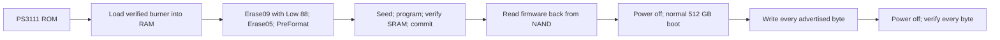

# GOODRAM CX400 512 GB recovery — Phison PS3111

A documented recovery of one SSD stuck in **PS3111 / SBRM02.0 ROM mode**, reporting 0 MB or 20 MB. The drive was restored to **512,110,190,592 bytes**. A complete write followed by a power-off and a full verified read confirmed data retention.

**This procedure erases the SSD. It restores operation; it does not recover files.** The code is specific to the controller, NAND geometry, firmware images and host configuration documented below. The name “CX400” alone does not establish compatibility.

The verified result has a qualification: the Lenovo host/caddy/SSD combination produced SATA errors at 3 Gb/s. The subsequent full read at **1.5 Gb/s** passed in **59 min 48 s**, with no new CRC errors or hardware resets. The cause of the higher-speed link errors remains unresolved.

## Start here

1. [Recovery procedure](docs/procedure.md): prerequisites, commands and completion criteria.
2. [Preparing firmware assets](docs/assets.md): reproduce the required files locally; vendor binaries are not distributed here.
3. [Adapting the code](docs/adapting.md): device identity, port and firmware guards that must be reviewed for another case.
4. [Protocol correction](docs/protocol.md): the Erase09 LBA Low `0x88` requirement.
5. [Results and limitations](docs/results.md): full-capacity coverage, cold-read evidence and SATA qualification.
6. [Troubleshooting](docs/troubleshooting.md), [evidence provenance](docs/evidence.md) and [sources](docs/sources.md).

## Tested hardware

| Item | Value |
|---|---|
| SSD | GOODRAM CX400 512 GB; case marking DC 1948 |
| Controller / PCB | PS3111-S11-13 / A11701NP004402N-V3 |
| NAND | Toshiba 64L BiCS3 TLC, 16 KiB pages; TA8BG53AII markings |
| Full Flash ID | `98 3e 99 b3 7a 72 08 06` |
| CE indices | `0, 1, 2, 3, 8, 9, 10, 11` |
| Normal firmware | SBFM61.3 |
| RAM burner | SBBQ61L3 |
| Initial identity | PS3111 / SBRM02.0, 0 MB or 20 MB |
| Successful connection | Native SATA through the optical-bay caddy in a Lenovo IdeaPad Z565, `ata4` |
| Stable read configuration | `pci=nomsi libata.force=4:1.5Gbps` on that host |
| Restored identity | SATA SSD / SBFM61.3, 512,110,190,592 bytes |

The serial number in the historical test scripts and evidence was **generated during reinitialization**. It is retained to connect the write/read records and device guards. It is not an identifier to copy onto another SSD.

## What worked



The decisive correction was in the Linux implementation of EraseAll mode09: the SBBQ61L3 receiver required **LBA Low `0x88`**. The earlier `0x00` frame was immediately rejected. Static receiver/host analysis identified the mismatch; actual programming and NAND readback then confirmed the complete sequence.

## Repository contents

| Directory | Purpose |
|---|---|
| `docs/` | English instructions, findings and limitations |
| `scripts/recovery-v2/` | Preserved recovery source and expected asset hashes; requires locally prepared firmware |
| `scripts/final-test-v2/` | Historical write/read code and v3/v4 read-only verifiers |
| `evidence/` | Selected fio/SMART records, a recovery summary and disclosed privacy redactions |
| `manifests/` | Public-file integrity and provenance, without private filesystem inventories |
| `tools/` | Local asset preparation and offline repository validation |

The private working archive, vendor EXE/DLL files, firmware `.bin` files, raw RAM/NAND dumps and full host logs are excluded. This repository has a separate initial history; it does not inherit the private archive's commits.

The hardware-facing Python sources preserve their tested bytes and some original Polish diagnostics. English documentation explains their operation and stop conditions. Sanitized test fixtures are identified in the provenance manifest.

## Validate without hardware

Python 3.13 is recommended. These checks do not require root, fio, smartctl or an attached SSD:

```sh
python3 -B tools/verify_repository.py --offline-tests
```

The public checks cover evidence, documentation links, byte integrity and the final-test/parser/read-guard tests. The **236 recovery checks require the separately prepared vendor assets**:

```sh
python3 -B tools/verify_repository.py --offline-tests --recovery-assets work/recovery-v2
```

See [asset preparation](docs/assets.md) before running the second command. Missing assets are reported explicitly; a public-only validation does not claim to have checked them.

This is one verified case, not a general PS3111 repair utility or a claim of restored lifetime/reliability at 3/6 Gb/s. See [third-party materials](THIRD_PARTY.md) for provenance and distribution boundaries.
